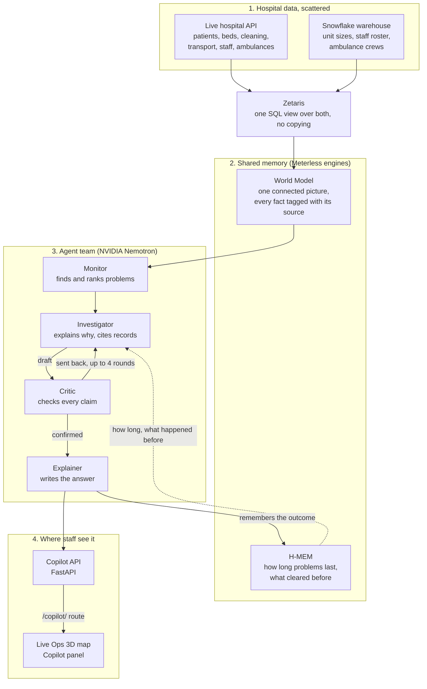

# Live Ops Copilot

**Team Mirror Works · Open Agent Hackathon 2026 · Track 1: Solving Fragmented Intelligence**

Hospital operations data is split across systems that don't talk to each other. A live operations feed knows where patients, beds, cleaners and transporters are right now. A separate data warehouse holds the official unit sizes, staff rosters and ambulance crews. The problems that back up a hospital, like patients stuck in the Emergency Department while beds upstairs are held by people who could already go home, only show up when you join those systems and watch them over time.

Live Ops Copilot is a team of AI agents that does exactly that. It reads both sources through **Zetaris**, builds one shared, source-tracked picture of the hospital with the **Meterless World Model**, remembers how long each problem has lasted with **Meterless H-MEM**, and explains *why* things are stuck using **NVIDIA Nemotron**. A Critic agent checks every claim against the data before an operator sees it. The answers appear inside the Live Ops 3D map.

---

## What an operator sees

A real answer from the live system, shortened (Live Ops map, Copilot panel):

> **Checked and confirmed by the Critic (1 round)**
>
> **What:** Two patients on unit 3W (P7307653 in 3W-305A, P7307713 in 3W-309A) are cleared for discharge with no transport requested, still holding beds.
>
> **Do now:** request transport for both patients to free 3W-305A and 3W-309A.
>
> **What the Copilot remembers:** this problem was first observed 75 minutes ago and has been seen in 20 checks.
>
> **How the agents got there:** Investigator draft, then the Critic's verdict, round by round.

No single source shows this. Patient status, bed status and transport requests come from the live feed; official unit capacity comes from the warehouse; the duration comes from H-MEM.

---

## Architecture



Every agent step is logged to `logs/*.jsonl`, and every memory change to `memory/ledger.jsonl`.

| Component | File | What it does |
|---|---|---|
| Data access | `zetaris_tool.py` | SQL against Zetaris, with automatic login and token refresh |
| Sources | `sources.py` | Live snapshot (patients, beds, cleaning, transport, staff, ambulances) and reference data (units, roster, ambulance crews, floors, locations) |
| World Model | `world_model.py` | Meterless World Model: stable IDs, per-source values with timestamps, relations, idempotent ingest |
| Monitor | `issues.py` | Finds full units, discharge backlogs, blocked or stale ED boarders, overdue cleaning, stale bed records, feed mismatches; each issue carries its evidence |
| H-MEM | `hmem.py` | Meterless H-MEM: working, episodic and semantic memory plus a ledger, as plain files in `memory/` |
| Agents | `agents.py` | Collector, Monitor, Investigator, Critic, Explainer; up to 4 rounds of critique and revision |
| API | `api.py` | `GET /issues`, `POST /investigate`, `GET /memory` |
| Live Ops panel | `integrations/liveops-panel/` | The Copilot panel added to the Live Ops map (React + TypeScript) |
| LLM | `llm.py` | NVIDIA Nemotron through an OpenAI-compatible endpoint |
| Logging | `logger.py` | JSONL trace of every step, one file per run |
| Exploration | `scripts/` | One-off tools used to map the data sources (schemas, ID overlap, name checks); run as `python -m scripts.<name>` |

---

## How the agents work

1. **Collector** pulls fresh data from both sources through Zetaris into the World Model.
2. **Monitor** finds and ranks problems, and attaches the exact records each finding rests on.
3. **Investigator** (Nemotron) explains the cause and proposes at most two actions. Every factual statement must cite an entity, attribute and value from the evidence.
4. **Critic** checks the draft in two ways:
   - **in code**: every cited entity must exist in the World Model, belong to this issue's evidence, and have the cited value;
   - **with Nemotron**: is the cause supported, is normal activity being called a failure, does each action target something still unresolved, is the confidence justified?

   Blocking problems send the draft back to the Investigator with all feedback so far. Minor ones are noted.
5. **Explainer** writes the operator message. If the agents never agree, the answer is labelled **unverified** and shows the Critic's open concerns, instead of a confident guess.

During development the Critic caught real mistakes in our own Monitor: a patient counted as having "no transport" who had a completed transport, `pending_discharge` treated as "ready to leave" when discharge was days away, and a finding that mentioned a boarder without including that patient as evidence. Each led to a fix.

---

## Meterless engines used

### World Model (`world_model.py`)

The shared state every agent reads and writes.

- **Stable IDs:** `bed:4E-410A`, `patient:P7307230`, `staff:S1023`, `unit:ICU`
- **Provenance:** each attribute holds a value per source (`live_api`, `snowflake_ref`) with the time it was observed
- **Relations:** patient in bed, bed in unit, nurse rostered to unit, staff located at location (about 550 per snapshot)
- **Idempotent ingest:** loading the same data twice produces an empty diff (tested)

### H-MEM (`hmem.py`)

Gives the agents a sense of time that the live feed lacks.

| Tier | File | Holds |
|---|---|---|
| Working | `memory/working.json` | Open issues and tracked patient statuses, with when each was first seen |
| Episodic | `memory/episodic.jsonl` | Every investigation, and every issue that cleared with how long it lasted |
| Semantic | `memory/semantic.json` | Lessons consolidated from repeated episodes |
| Ledger | `memory/ledger.jsonl` | Every memory write, with its reason |

- **Conflict rule:** a newer live observation replaces an older one, and the ledger records what was replaced and why.
- **Grace period:** an issue must be absent for 3 minutes before it counts as resolved, so brief flickers in live data don't reset its clock.
- `python agents.py --watch N` builds memory once a minute without any model calls.

---

## Live Ops integration

Live Ops (pre-existing, see below) is a 3D live operations map. The Copilot appears in it as a **Copilot** toolbar button and panel:

- the current problems, refreshed every minute, with how long each has been open;
- **Find out why**, which runs the agent team and shows the verified answer, what the Copilot remembers, and the Investigator and Critic rounds;
- **Show** buttons that jump to each cited patient or bed on the map.

Live Ops' page security policy only allows calls to itself (`connect-src 'self'`), so instead of loosening it, Live Ops' nginx passes `/copilot/` to the Copilot API:

```nginx
location /copilot/ {
  proxy_pass http://host.docker.internal:8100/;
  proxy_read_timeout 180s;
}
```

The panel code is in `integrations/liveops-panel/` (`useCopilot.tsx`, `copilot.css`). Live Ops itself needs three small edits to its map page: an import, the hook, and the toolbar button and panel.

---

## Sponsor technology

**Zetaris:** the data layer. One SQL interface over a live REST API and a Snowflake warehouse, with no copying. Every read in this project goes through Zetaris.

**Meterless:** two engines implemented, World Model and H-MEM, as described above, each with passing tests.

**NVIDIA Nemotron:** the reasoning model for the Investigator, Critic and Explainer (`nemotron-3.5-lightning-30b-a3b` via the NVIDIA API).

**AI coding tools:** the World Model and its first tests were built with Cursor's agent (screenshots in the submission). Later work was written with Claude.

---

## Setup

Requirements: Python 3.11+, a running Zetaris instance with two sources (`api` for the live hospital feed and `riverside` for the Snowflake warehouse), and an NVIDIA API key.

```bash
git clone https://github.com/anugurashmitha8/liveops-copilot.git
cd liveops-copilot
python -m venv venv
venv\Scripts\activate          # Windows
# source venv/bin/activate     # macOS / Linux
pip install -r requirements.txt
```

Copy `.env.example` to `.env` and fill in your Zetaris and NVIDIA settings. `.env` is git-ignored.

## Run

```bash
python -m pytest tests/ -v                 # 14 tests: World Model, H-MEM, Monitor, Critic
python world_model.py                      # build the World Model, save logs/world_model_snapshot.json
python issues.py                           # detect problems, save logs/issues_latest.json
python agents.py --watch 5                 # build memory: one check a minute for 5 minutes, no model calls
python agents.py                           # investigate the most urgent problem
python agents.py --issue 1                 # or the second one
uvicorn api:app --host 0.0.0.0 --port 8100 # the Copilot API, docs at http://localhost:8100/docs
```

Every run writes a trace to `logs/run_*.jsonl` and saves the full answer to `logs/answer_run_*.json`.

## API

| Endpoint | Returns |
|---|---|
| `GET /issues` | Current ranked problems, each with a stable `key`, how long memory has seen it, and how many checks |
| `POST /investigate` `{"key": "..."}` | The agent team's answer: verified or not, the message, memory, and every round. If that problem has just cleared, the agents investigate what is still going on in the same unit |
| `GET /memory` | Open issues, lessons and recent episodes from H-MEM |

---

## Notes on the data

The hospital data is **simulated**; no real patients are involved.

The Snowflake warehouse runs its own separate patient simulator, so its patients never match the live feed (0 shared). Staff and beds do match across both sources (74 of 74 staff, 118 of 118 beds). This project therefore takes all live activity from the API and uses Snowflake only for reference data: unit capacities, staff roster and shifts, ambulance crews, floors and locations. The Live Ops map shows the same live-API patients the agents use.

## Pre-existing components

Built before the hackathon and used here as infrastructure, not part of this entry:

- **Live Ops**, the 3D operations map, including its rule-based "Ask" (what changed), its sensor "Watch" (statistical anomaly detection), its optional LLM rephrasing with a numbers guard, and its on-site connector (`tools/liveops-agent` in the Live Ops codebase, unrelated to this repo);
- the **Zetaris** instance and its source connections;
- the **live hospital API simulator** and the **Snowflake warehouse** with its simulator.

Everything in this repository, plus the Copilot panel, its hook-up in the Live Ops map page and the `/copilot/` nginx route, was written during the hackathon, starting 22 October 2026.

## License

MIT